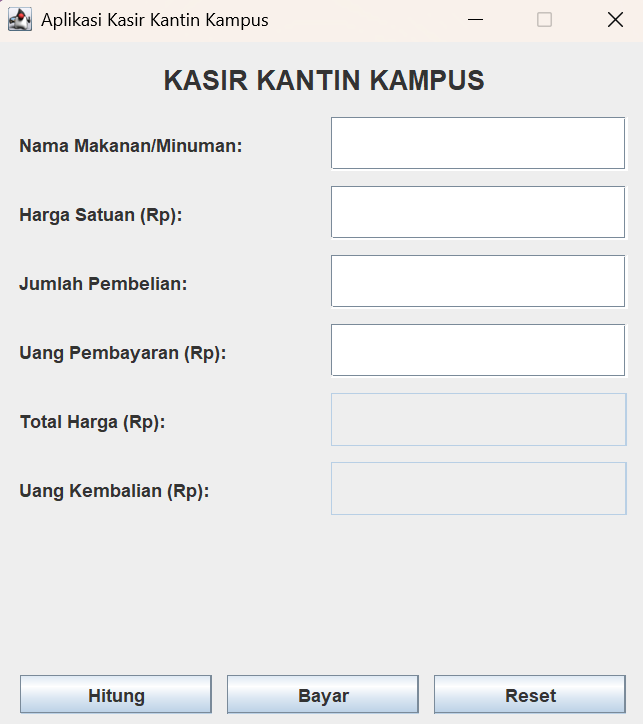
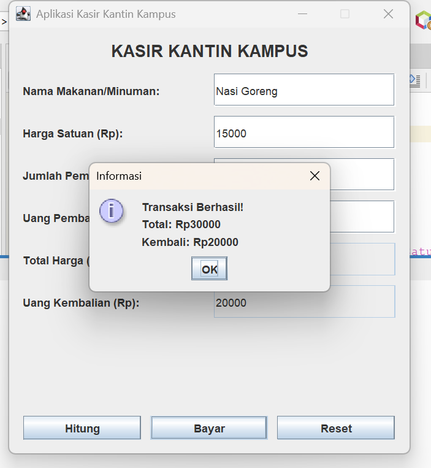

# Aplikasi Kasir Kantin Kampus

## Identitas Mahasiswa
* **Nama Lengkap:** RIZA FITRIA
* **NIM:** C2483207031
* **Kelas:** V/PT15[cite: 1]
* **Mata Kuliah:** Pemrograman Visual[cite: 1]

## Deskripsi Singkat
Aplikasi desktop sederhana berbasis Java Swing untuk membantu pencatatan transaksi penjualan makanan atau minuman di kantin kampus secara digital, menghitung total harga, memproses pembayaran, menghitung uang kembalian, serta menyediakan validasi input agar terhindar dari kesalahan hitung[cite: 1, 2].

## Daftar Fitur
1. Input data transaksi (Nama barang, Harga satuan, Jumlah pembelian, Uang pembayaran).
2. Penghitungan otomatis Total Harga.
3. Penghitungan otomatis Uang Kembalian.
4. Validasi input ketat (mencegah kolom kosong, nilai negatif, format bukan angka, dan uang pembayaran kurang).
5. Tombol Reset untuk mengosongkan formulir dan mengembalikan kursor fokus ke input awal.

## Komponen Java Swing yang Digunakan
* `JFrame` (Jendela utama aplikasi)
* `JPanel` (Wadah tata letak komponen)
* `JLabel` (Label teks informasi dan judul)
* `JTextField` (Kolom teks untuk input dan output data)
* `JButton` (Tombol aksi Hitung, Bayar, dan Reset)
* `JOptionPane` (Kotak dialog peringatan dan informasi)

## Petunjuk Menjalankan Aplikasi
1. Buka **Apache NetBeans IDE**.
2. Pilih menu **File > Open Project**, lalu arahkan ke folder direktori proyek NetBeans Anda (`UTS-Pemrograman-Visual-NIM`).
3. Pastikan seluruh struktur folder (`src`, `nbproject`) lengkap.
4. Klik kanan pada file `KasirKantin.java`, lalu pilih **Run File** (Shift + F6).

## Dokumentasi Pengujian Aplikasi
Berikut adalah tangkapan layar hasil pengujian aplikasi:

### 1. Tampilan Utama Aplikasi

### 2. Hasil Perhitungan Total Harga dan bayar nasgor

### 3. Hasil Perhitungan Total Harga dan bayar mie ayam

### 4. Hasil Perhitungan Total Harga dan bayar es teh

